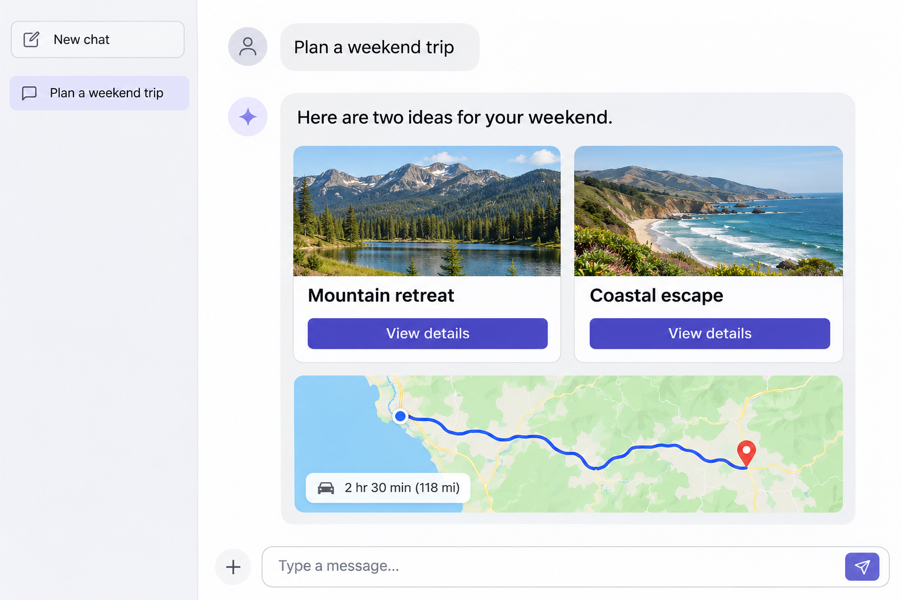

# What Is AIUI?

## Getting to Know AI-Native UI

You may already be used to chatting with AI: ask a question and read its answer. But text isn't always the easiest way to compare travel plans, adjust a budget, or understand a complex idea. What if AI could also present a diagram, a set of choices, or a small interactive tool?

That's a central idea behind **AI-native user interfaces (AI-Native UI)**: combining AI's ability to understand a request with an interface built around the user's goal. Users can describe what they need in conversation, then use the interface to explore information, make choices, and continue with the task. The content and presentation can change with the task and its context.

For example, you might say, “Help me plan a weekend trip.” AI could organize a few destinations into cards showing travel times and highlights. After you choose one, you could use an interface to review or adjust the itinerary. For a simple question, a clear text answer might be enough. The aim is to choose a form that helps the user with the task at hand.

*Interface mockup: trip suggestions appear as cards and a route map. This conceptual example is not a screenshot of a real product.*

Try the weather example below: look at the card in the conversation and use its buttons.

<in-chat-interaction-demo></in-chat-interaction-demo>

### A Look at ChatGPT's Intelligent UI

OpenAI's [introduction to GPT-6 and Intelligent UI](https://openai.com/index/gpt-6-for-everyone/) illustrates a similar idea: ChatGPT can combine text, visuals, and interactive elements based on the question. For example, it can use an interactive diagram to help someone explore a complex topic or provide a calculator within a conversation. It can also answer in text when that's the useful choice.

This is one example of an AI-native interface in practice. It shows how an interface can extend a conversation, letting people explore and act on an answer as well as read it.

### How Does It Relate to Familiar Interfaces?

In a traditional application, developers usually design pages and workflows in advance, and users find features through menus, buttons, and forms. An AI-native interface can still use those familiar elements, while also letting users express a goal in natural language and presenting relevant information and actions for the task.

It doesn't require AI to generate every page on the spot: developers can design interfaces in advance, and content can also be organized around the context where appropriate. In either case, the goal is to make it easier to understand information, make choices, and complete a task.

## What Is AIUI?

**AIUI is a UI framework for developing AI agents.** An agent is an AI assistant designed to help users achieve a particular goal, such as checking the weather or preparing to go out.

AIUI helps developers create cards, pages, and interactions for an agent, so users can both talk to AI and complete tasks through an interface. You can use it to develop agents for Rokid glasses.

ChatGPT's Intelligent UI is a product experience; AIUI provides tools for building AI-native interactions. Let's look at two examples of what you can build with AIUI.

## What Can You Build with AIUI?

An AIUI interface can appear in a conversation or open as a standalone experience. Here are two examples:

### Show a Card in a Conversation

The weather example above is a conversational interface: AI displays a card in the conversation, and the user can check information and interact with it without leaving the chat.

This approach works well for simple interactions such as weather queries, itinerary confirmations, and search results.

### Complete a Task in a Standalone Interface

Some tasks involve ongoing actions and changing information, such as playing a game of Landlord. A complete interface can show the table, cards, and buttons, giving the user a place to continue interacting.

<standalone-interaction-demo></standalone-interaction-demo>

This approach works well for games and task panels that involve multiple steps or need to show changing state.

## From an Idea to an Agent

Imagine building an assistant that helps users check the weather and prepare before going out. Start with one small goal: when someone asks about the weather, show a card with the city and weather information.

In AIUI Studio, you can get started like this:

1. **Describe the idea**: Tell the AI assistant what the card should show and what users should be able to do.
2. **Create and refine the interface**: Generate a project, inspect the card, and adjust its text, layout, and interactions.
3. **Preview and check**: Preview it in the browser and check that the information is clear and the interactions work as expected.
4. **Try it on a device**: When you're ready, debug it on the glasses to experience how it looks and feels in use.

The screenshot below shows a weather interface in AIUI Studio. The preview in the center shows the interface for the glasses, while the controls on the right let you simulate input and temple gestures to check the experience.

Once the weather card is working, you could add reminders or itinerary information. Finishing one small feature first makes it easier to see your progress and expand from there.

To show live weather, you'll also need to connect a weather data service. AI can help write the code, but you'll still need to check the information, verify the interactions, and adjust the project as needed.

## Where Should I Start?

Ready to build? Start by creating a project with **AIUI Studio** in your browser. Then choose an example based on the kind of interaction you want to explore:

- [AIUI Studio quick start](./quickstart.en-US.md): Create and preview your first project.
- [Conversational AIUI](./first-chat.en-US.md): Try showing a weather card in a chat.
- [Immersive AIUI](./first-immersive.en-US.md): Try building a standalone game interface.

You don't need to decide on every technical detail first. Pick an example that interests you and learn about AIUI projects, components, and interactions as you build.

## Already Have Development Experience?

If you're familiar with Web or WeChat Mini Program development, you can use familiar approaches to build AIUI pages. AIUI provides common Web APIs and supports some WeChat Mini Program components and APIs; check the relevant reference documentation for specific support.

You can also learn how to [develop with AI](./ai-dev.en-US.md) and use an AI assistant to help write and modify your AIUI project.
