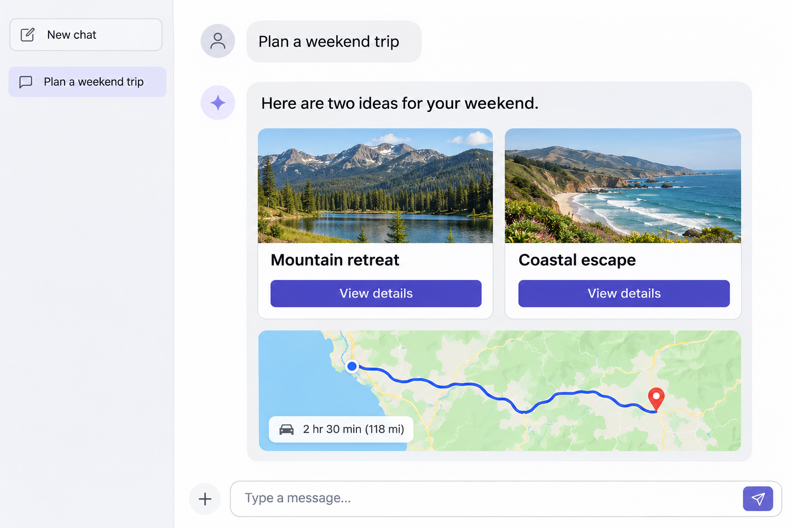

# 什么是 AIUI？

## 先认识 AI 原生界面

你可能已经习惯了和 AI 聊天：提出问题，然后阅读它的文字回答。但如果你想比较几种旅行方案、调整预算，或者看懂一个复杂的概念，文字不一定是最方便的形式。要是 AI 能把信息变成一张图、一组可以选择的选项，或一个可以动手操作的小工具呢？

这就是 **AI 原生界面（AI-Native UI）** 的一个核心想法：围绕用户的目标，将 AI 的理解能力与界面结合起来。用户可以通过对话表达需求，也可以通过界面查看信息、做出选择和继续操作。界面的内容和呈现方式可以随着任务和上下文变化。

例如，你说“帮我规划一次周末出游”。AI 可以先整理出几个目的地，用卡片展示交通时间和特色；你选择其中一个后，再通过界面查看行程或调整安排。对简单问题，一句清楚的文字回答也可能已经足够。关键是选择有助于用户完成当前任务的表达方式。

*界面示意图：旅行建议以卡片和路线图呈现。此图用于说明概念，并非实际产品截图。*

你也可以试试下面这个天气示例：查看对话中的卡片，并点击卡片上的按钮。

<in-chat-interaction-demo></in-chat-interaction-demo>

### 从 ChatGPT 的 Intelligent UI 看起

OpenAI 在 [GPT-6 和 Intelligent UI 介绍](https://openai.com/index/gpt-6-for-everyone/)中展示了类似的思路：ChatGPT 可以根据问题组合文字、图像和交互元素。例如，用可交互的图示帮助用户探索复杂概念，或在对话中提供一个计算工具。需要简单回答时，它也可以直接使用文字。

这是 AI 原生界面的一种具体体验。它帮助我们理解：界面可以成为对话的延伸，让用户不仅能听到答案，还能围绕答案探索和行动。

### 它与熟悉的应用界面有什么关系？

传统应用通常由开发者预先设计好页面和操作流程，用户通过菜单、按钮和表单找到所需功能。AI 原生界面仍然可以使用这些熟悉的元素，但也让用户用自然语言表达目标，并结合当前任务呈现相关信息和操作。

它不要求每个页面都由 AI 临时生成：界面可以由开发者预先设计，也可以在适合的场景中根据上下文组织内容。无论采用哪种方式，重点都是让用户更容易理解信息、作出选择并完成任务。

## 什么是 AIUI？

**AIUI 是一个用于开发 AI 智能体的界面框架**。这里的“智能体”可以理解为一个围绕特定目标帮助用户完成任务的 AI 助手，比如天气助手或出门助手。

AIUI 帮助开发者为智能体创建卡片、页面和交互，让用户既能和 AI 对话，也能通过界面完成任务。你可以用它为 Rokid 眼镜开发智能体。

ChatGPT 的 Intelligent UI 是一种产品体验；AIUI 则提供开发这类 AI 原生交互的工具。下面通过两个例子看看你可以用 AIUI 构建什么。

## AIUI 能做什么？

AIUI 可以让界面出现在对话中，也可以提供一个独立的界面。先从两个例子感受一下：

### 在对话中展示卡片

上面的天气示例就是一种对话式界面：AI 在对话中展示卡片，用户可以直接查看信息并进行操作，无需离开当前对话。

这种方式适合天气查询、行程确认、搜索结果等交互简洁的场景。

### 在独立界面中完成任务

有些任务需要持续操作和查看状态，比如玩一局斗地主。此时可以用一个完整界面展示牌桌、手牌和操作按钮，让用户围绕这个界面继续交互。

<standalone-interaction-demo></standalone-interaction-demo>

这种方式适合游戏、任务面板等需要多个步骤或持续展示状态的场景。

## 从一个想法到一个智能体

假设你想做一个出门助手，帮助用户在出门前查看天气和准备事项。可以先从一个简单的目标开始：当用户询问天气时，展示一张包含城市和天气信息的卡片。

在 AIUI Studio 中，你可以这样开始：

1. **描述需求**：告诉 AI 助手，你希望卡片展示什么、用户可以做什么。
2. **创建和调整界面**：生成项目后，查看卡片效果，继续调整文字、布局和交互。
3. **预览和验证**：在浏览器中预览，检查信息是否清楚、操作是否符合预期。
4. **尝试真机体验**：准备好后，在眼镜上调试，感受实际的显示和交互效果。

下面是 AIUI Studio 中预览天气界面的截图：中间的预览区展示眼镜中的界面，右侧可以模拟输入和镜腿操作，帮助你检查效果。

等天气卡片运行起来，你还可以继续添加待办提醒或行程信息。先完成一个小功能，再逐步扩展，通常更容易看到进展。

如果希望卡片展示实时天气，还需要接入天气数据服务。AI 可以协助编写代码，但你仍需要检查信息、验证交互，并在需要时调整项目。

## 我该从哪里开始？

准备好动手了吗？推荐先使用运行在浏览器中的 **AIUI Studio**，跟随快速入门创建项目。之后，你可以根据感兴趣的交互方式选择示例：

- [AIUI Studio 快速入门](./quickstart.md)：创建并预览你的第一个项目。
- [对话式 AIUI](./first-chat.md)：尝试在聊天中展示天气卡片。
- [沉浸式 AIUI](./first-immersive.md)：尝试构建一个独立的游戏界面。

你不需要先选定所有技术方案。先挑一个感兴趣的例子，边做边了解 AIUI 的项目结构、组件和交互方式即可。

## 已经有开发经验？

如果你熟悉 Web 或微信小程序开发，可以在 AIUI 中使用熟悉的页面开发方式。AIUI 提供常用 Web API，也支持部分微信小程序的组件和 API；具体支持情况请以相应参考文档为准。

你也可以了解如何[使用 AI 开发](./ai-dev.md)，让 AI 助手帮助你编写和调整 AIUI 项目。
